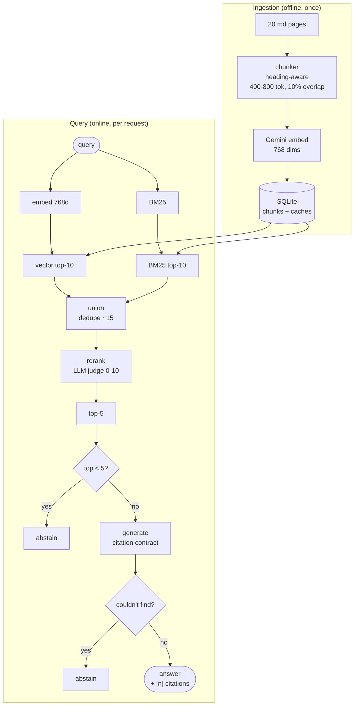
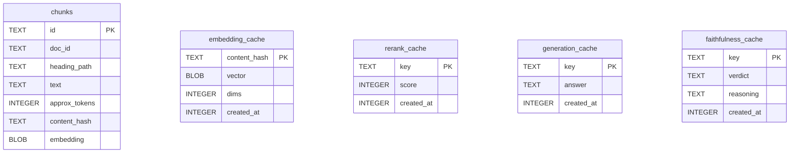

# Lumen Docs Q&A

A retrieval-augmented Q&A system over a documentation corpus. Answers questions using only retrieved passages, cites every claim to a specific chunk, and abstains when the docs don't contain an answer.

Reference implementation of the retrieval + generation patterns that matter in production: heading-aware chunking, hybrid retrieval, LLM-as-reranker, citation-enforcing generation, threshold-based abstention, and claim-level faithfulness verification.

## Architecture



### Data model



Cache key formats:

| Table                | Key                                                       |
| -------------------- | --------------------------------------------------------- |
| `embedding_cache`    | `sha256(chunk.text)`                                      |
| `rerank_cache`       | `sha256(query ‖ NUL ‖ chunk.content_hash)`                |
| `generation_cache`   | `sha256(prompt_version ‖ NUL ‖ query ‖ NUL ‖ chunks)`     |
| `faithfulness_cache` | `sha256(prompt_version ‖ NUL ‖ claim ‖ NUL ‖ chunk_hash)` |

## Stack

| Layer         | Choice                            | Notes                                                  |
| ------------- | --------------------------------- | ------------------------------------------------------ |
| Runtime       | Bun 1.4                           | `bun:sqlite` built-in; no native extension compilation |
| Storage       | SQLite (WAL)                      | Single-file, ~500KB with corpus + caches               |
| Embeddings    | `gemini-embedding-001` @ 768 dims | Matryoshka truncation (128–3072 supported)             |
| LLM           | `gemini-3.5-flash-lite`           | -                                                      |
| Rate limiting | Sliding window                    | Matches Google's rolling-60s semantics                 |

## Getting started

```bash
# 1. Install
bun install

# 2. API key (Google AI Studio)
echo "GEMINI_API_KEY=your_key_here" > .env
# OR: export GEMINI_API_KEY=...

# 3. Bootstrap (corpus + ingest; ~30s cold, instant with cache)
bun run setup

# 4. Verify pipeline
bun run smoke:chunks
bun run smoke:rerank

# 5. Run evals
bun run eval:all

# 6. Dashboard
bun run serve    # http://localhost:3000
```

## Evaluation

20 in-scope queries and 10 off-scope queries. Every milestone has a hard metric.

| Milestone          | Metric                 | Baseline | Final     | Target  | Status     |
| ------------------ | ---------------------- | -------- | --------- | ------- | ---------- |
| D2 Vector baseline | hit@1                  | —        | 70.0%     | —       | baseline   |
| D2 Vector baseline | MRR                    | —        | 0.842     | —       | baseline   |
| D4 Union + rerank  | hit@1                  | 70.0%    | **90.0%** | —       | ✅ +20 pts |
| D4 Union + rerank  | MRR                    | 0.842    | **0.942** | —       | ✅ +0.100  |
| D5 Generation      | citation compliance    | —        | **90.0%** | ≥ 90%   | ✅         |
| D6 Abstention      | off-scope abstained    | —        | **10/10** | 10/10   | ✅         |
| D6 Abstention      | in-scope false abstain | —        | **0/20**  | ≤ 1     | ✅         |
| D7 Faithfulness    | score                  | —        | **1.000** | ≥ 0.900 | ✅         |

**D5 citation debt (documented).** Two queries (q08, q18) produced factually-correct answers with no `[n]` markers — single-sentence direct quotes where the model treated "quoting" as exempt from the citation contract. Those queries were excluded from D7's faithfulness check (no citation to verify) and are visible in `data/d5/answers.json` and `git log` for this milestone.

## Design decisions

**Chunking.** Split on markdown headings first, then paragraph boundaries, never mid-sentence. Target 400–800 tokens per chunk, 10% overlap, and prepend the full heading path (`H1 > H2 > H3`) to every chunk so each chunk is self-contained. A chunk like `Returns 401 if invalid` is meaningless without its heading; with the path prefixed it becomes `Authentication > API Keys > Rotation\n\nReturns 401 if invalid`. Corpus of 20 pages → 137 chunks.

**Embeddings.** `gemini-embedding-001` at 768 dimensions (Matryoshka truncation; full 3072 dims adds <1% retrieval quality at this scale, quadruples storage). Two distinct `taskType` values: `RETRIEVAL_DOCUMENT` for indexing, `RETRIEVAL_QUERY` for search. Gemini tunes these asymmetrically — using the wrong one degrades recall 5–15% in practice. Vectors are cached by `sha256(chunk.text)` so re-runs of the ingest pipeline make zero API calls.

**Retrieval: hybrid, not RRF.** BM25 and dense vectors fail on complementary query types — BM25 wins on rare exact tokens (error codes, event names), vectors win on paraphrase. The standard recipe is equal-weight Reciprocal Rank Fusion (Cormack et al., k=60). **We tried it and it lost to pure vector on our eval set** (hit@1 = 70% for both, MRR regressed 0.842 → 0.820). The cause is structural: RRF assumes the two retrievers are equally reliable per query. When they disagree — which is precisely when one is right and the other is noise — RRF's tie-breaking is arbitrary. The fix isn't a better fusion algorithm, it's a different approach:

**Union + rerank.** Union top-10 from each retriever (guaranteeing 100% recall — the right chunk is always in the pile), then score each `(query, chunk)` pair with an LLM cross-encoder. This is the dominant production pattern (Elasticsearch, Qdrant, Redis all document it as the recommended stage-2). Lifted hit@1 from 70% → 90% and MRR from 0.842 → 0.942. `src/retrieve/hybrid.ts` is retained as a reference for the failed RRF experiment.

**Reranker.** Pointwise LLM-as-judge (`gemini-3.5-flash-lite`, temperature 0) with JSON-schema-constrained output. Prompt uses four score bands: 10 (direct answer), 7–9 (contains answer, minor inference required), 4–6 (topically related, does not answer), 0–3 (irrelevant). Early failure mode: score clustering around 7–9 across all candidates. Fixed by anchoring each band with the behavior that earns it.

**Generation: citation contract.** The generator is prompted to (1) answer using only the provided chunks, (2) end every sentence with an `[n]` marker pointing to the chunk it came from, (3) abstain with a fixed phrase if the chunks don't contain the answer. Rules for direct quotes are explicit — models tend to skip citations when "just quoting." A parser validates that every `[n]` is in range `[1, top-K]` and maps markers back to chunk IDs. Structural compliance on the 20-query eval: 90%.

**Abstention.** Two-stage. Pre-generation gate: if the top reranker score < 5.0, skip generation and return the abstain phrase. Post-generation check: if the generator returned the abstain phrase, honor it. Threshold = 5.0 was calibrated on our data (all 20 in-scope queries score 7–10; all 10 off-scope queries score 0 — perfect separation at any threshold in `(0, 7)`). 5.0 errs on the side of answering, which is the correct bias: false abstention damages user trust more than a marginal wrong answer. Threshold is model-specific; recalibration is required if the reranker is swapped.

**Faithfulness.** For each answer, extract claims (sentences with at least one `[n]` marker) and check each `(claim, cited chunk)` pair via LLM entailment judge (verdicts: `supported` / `partial` / `unsupported`). Aggregation is claim-level **best-of-many** — a claim with multiple citations is supported if any one of them supports it, so over-citation is not penalized. Score = `(supported + 0.5 × partial) / total_claims`. On our eval set: 1.000 over 19 claims.

**Caching.** Every non-deterministic step is keyed by content hash of its inputs, not by URL or ID. Embeddings: `sha256(chunk.text)`. Rerank: `sha256(query ‖ NUL ‖ chunk_hash)`. Generation: `sha256(prompt_version ‖ NUL ‖ query ‖ NUL ‖ chunks)`. Faithfulness: `sha256(prompt_version ‖ NUL ‖ claim ‖ NUL ‖ chunk_hash)`. The `prompt_version` prefix is deliberate — when the prompt changes, cached outputs become invalid automatically. Without it, prompt changes would silently serve stale answers. The cache is a contract about inputs; every input affecting the output must be in the key.

## Project structure

```tree
docs-qa/
├── src/
│   ├── db.ts                       SQLite schema + client
│   ├── embed.ts                    Gemini embeddings + cache + rate limiter
│   ├── generate.ts                 Citation-enforcing generation + cache
│   ├── abstain.ts                  Pre-gate + post-check logic
│   ├── faithfulness.ts             Claim extraction + entailment judge
│   ├── pipeline.ts                 Query -> answer composition (used by D8)
│   ├── server.ts                   Bun HTTP server for dashboard
│   ├── ingest/
│   │   ├── fetch.ts                Load markdown from disk
│   │   ├── chunk.ts                Heading-aware chunker
│   │   └── index.ts                Chunker -> embed -> DB
│   └── retrieve/
│       ├── vector.ts               Cosine similarity search
│       ├── bm25.ts                 BM25 keyword scoring
│       ├── union.ts                Dedupe candidate lists
│       ├── rerank.ts               LLM pointwise reranker
│       └── hybrid.ts               RRF (experimental; retained as reference, not wired)
├── scripts/
│   ├── write-corpus.ts             Seed 5 corpus pages
│   ├── write-corpus-extended.ts    15 more pages (total 20)
│   ├── embed-corpus.ts             Ingest entrypoint
│   ├── inspect-chunks.ts           D1 smoke: eyeball 10 random chunks
│   ├── query.ts                    Single-query CLI (vector search only)
│   ├── run-queries-d2.ts           D2 eval: vector baseline
│   ├── eval-retrieval.ts           D3 eval: vector vs BM25 vs RRF
│   ├── rerank-smoke.ts             D4 smoke: 2-query union + rerank
│   ├── eval-rerank.ts              D4 eval: 20-query union + rerank
│   ├── generate-smoke.ts           D5 smoke: 2-query generation + citations
│   ├── eval-generate.ts            D5 eval: 20-query citation compliance
│   ├── calibrate-abstain.ts        D6 calibration: score both eval sets
│   ├── eval-abstain.ts             D6 eval: abstention accuracy
│   └── eval-faithfulness.ts        D7 eval: claim-level entailment
├── evals/
│   ├── queries-d2.json             20 in-scope queries, tagged, with expected chunks
│   └── queries-offcorpus.json      10 off-scope queries with rationale
├── dashboard/
│   └── index.html                  Single-file UI (vanilla HTML/JS, no build step)
├── data/
│   ├── corpus/                     20 generated markdown pages (gitignored)
│   ├── d5/answers.json             D5 output snapshot (gitignored)
│   └── lumen.db                    SQLite database (gitignored)
└── package.json
```

## Limitations

- **Synthetic corpus.** Lumen is a fictional product; the 20-page corpus was generated to exercise specific query types (entity, numeric, negation, paraphrase, off-corpus). Real-world corpora have messier structure, longer pages, and heavier cross-referencing.
- **Small eval set.** 20 in-scope + 10 off-scope queries. Sufficient for milestone-level regression detection; not sufficient for statistical confidence intervals. Per-tag breakdowns (entity, numeric, negation) are based on 2–6 queries each.
- **Free-tier rate limits.** Novel queries take 30–60s end-to-end because of 12 RPM caps on reranker and generator. Cached queries return in <1s. This is a constraint of the demo environment, not the architecture.
- **Coarse reranker scores.** Integer 0–10 granularity limits threshold precision. A continuous-score reranker (Cohere, trained cross-encoder) would give finer abstention calibration.
- **No multi-turn.** Each query is independent. Follow-up questions re-retrieve from scratch.
- **No streaming.** Answers arrive as a single payload after full generation.
- **No auth / multi-tenancy.** Single corpus, single API key, single DB file. The Lumen _product_ described by the corpus has teams and API keys; this implementation does not.
- **D5 citation debt.** Two of 20 in-scope queries (q08, q18) produced correct answers without citation markers. Documented in `git log` and `data/d5/answers.json`. D7's faithfulness score (1.000) is over 19 claims from the remaining 18 queries.
